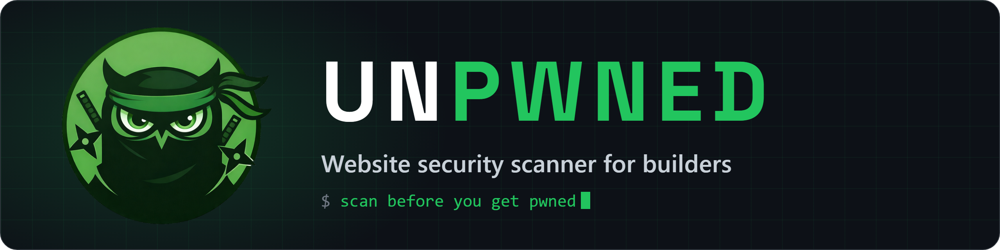

<div align="center">
  
  <br/><br/>

  Scan a live site or a GitHub repo, see what is exposed, and get a fix prompt for the AI tool you already use.<br/><br/>

  <a href="https://www.unpwned.io"></a>
  &nbsp;
  <a href="https://www.unpwned.io/security"></a>
  &nbsp;
  <a href="https://www.unpwned.io/security"></a>
  &nbsp;
  <a href="https://www.unpwned.io/security"></a>

  <br/>

  
  <br/>
  <sub>Results of a real scan of unpwned.io with the open source <a href="https://github.com/razazu/unpwned-cli">CLI</a>.</sub>

</div>

<br/>

## What UNPWNED Does

UNPWNED looks at your app from the outside, the way an attacker does, and turns what it finds into instructions your AI coding tool can act on.

- **Free scan, no signup**: 149 checks on any public site in a couple of minutes
- **Verified Deep Scan**: up to 702 configured checks across 33 coverage scanners once you prove you own the domain ([current check list](https://www.unpwned.io/checks))
- **Coverage**: SSL/TLS, security headers, exposed secrets and config files, Supabase and Firebase access, API routes, CORS, DNS and email authentication, open ports, version-linked CVEs, public cloud buckets
- **AI fix prompts**: redacted, finding-specific instructions shaped for 15 tools, including Claude, Cursor, ChatGPT, Copilot, Lovable, Bolt and v0
- **Re-scan to prove the fix**: before and after scores, with new regressions counted
- **Monitoring and CVE Radar**: scheduled scans, alerts to Slack, Discord or a webhook, and a live view of the CVEs that are actually being exploited (CISA KEV and EPSS)
- **GitHub repo scanning**: 49 credential patterns, CVE lookups against OSV, GHSA and NVD, read-only OAuth, and auto-created GitHub Issues

<br/>

## How It Works

```
1. Scan      -->  Paste a URL. Read-only, no signup.
2. Report    -->  Prioritized findings with a security score.
3. AI fix    -->  Copy the fix prompt into Claude, Cursor or any AI tool.
4. Re-scan   -->  Prove the fix and catch regressions.
```

<br/>

## Free Tools

No signup. Results are shown to you and not stored.

| Tool | What it does |
|------|--------------|
| [Agent Skill Scanner](https://www.unpwned.io/skill-scanner) | Checks a Claude Code or agent skill for hidden instructions, secret exfiltration and risky scripts before you install it. Reads the files, never runs them. |
| [SSL Certificate Checker](https://www.unpwned.io/tools/ssl-checker) | Certificate validity, protocol support and security grade |
| [Email Security Checker](https://www.unpwned.io/tools/email-security) | SPF, DKIM and DMARC records |
| [DNS Security Checker](https://www.unpwned.io/tools/dns-security) | DNSSEC, CAA records, nameservers and DNS health |
| [security.txt Validator](https://www.unpwned.io/tools/security-txt) | Validates a security.txt file against RFC 9116 |

<br/>

## Open Source

| Project | What it is |
|---------|------------|
| [unpwned-cli](https://github.com/razazu/unpwned-cli) | Website security scanner in your terminal: `npx unpwned scan yoursite.com` |
| [unpwned-action](https://github.com/razazu/unpwned-action) | GitHub Action that scans on every push and fails the build on critical findings |
| [slopsquat-guard](https://github.com/razazu/slopsquat-guard) | Claude Code hook that blocks AI-hallucinated and slopsquatted npm and pip packages before they install |
| [unpwned-skill-scanner](https://github.com/razazu/unpwned-skill-scanner) | Review checklist, eight exercises and a worksheet for vetting agent skills. Companion to the free Skill Scanner. |

<br/>

## Research

- **[Tripwire](https://www.unpwned.io/tripwire)**: fake vulnerabilities planted on our own site, and a running log of who comes looking
- **[Scan data](https://www.unpwned.io/data)**: what real scans find across the web, updated continuously
- **[Agent Proof](https://www.unpwned.io/agent-proof)**: a boundary-assessment program for AI agent builders, currently in preparation

<br/>

## Tech

| Layer | Stack |
|-------|-------|
| Frontend | Next.js 16, React, TypeScript, Tailwind CSS |
| Backend | Supabase (RLS on every table), Neon Serverless |
| AI | Claude API (Anthropic) for analysis and fix generation |
| Infra | Vercel, Cloudflare (WAF/DDoS), Resend (email) |
| Security | HMAC webhook verification, rate limiting, honeypot system, SSRF guard |
| Payments | Freemius (merchant of record) |

<br/>

---

<div align="center">
  <strong>Raz Azulay</strong><br/>
  Founder of UNPWNED. Building cybersecurity tools.<br/>
  Ofakim, Israel<br/><br/>
  <a href="https://www.unpwned.io">unpwned.io</a>
  &nbsp;·&nbsp;
  <a href="https://x.com/azulay_raz">X</a>
  &nbsp;·&nbsp;
  <a href="https://linkedin.com/in/razazulay">LinkedIn</a>
  &nbsp;·&nbsp;
  <a href="https://www.youtube.com/@UnpwnedIO">YouTube</a>
</div>
